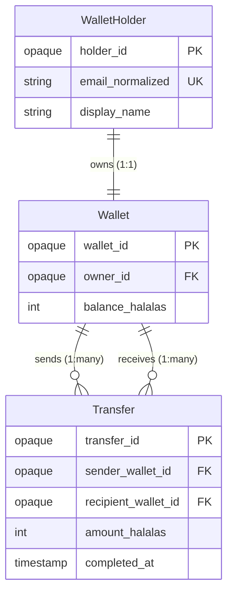

# Functional Specification: U1 Walking Skeleton

Conversation language: English.

This document is the **source of truth for workflows and state machines** in U1. The ER diagram and rules summary below are derived views of `entities.md` and `rules.md`.

Stories implemented in this unit: US1.2 (wallet setup via safety net), US1.3 (sign-in check), US2.1 (balance), US3.1 (send), US3.2 (review), US3.4 (balance check), US4.1 (history), US4.2 (received in history), US6.1 (end-to-end check on `dev`), US6.4 (opening balance).

U1 is a partial C1 pre-release. It provisions the dedicated `Transactions` table keyed by `transferId` and writes a completed transfer atomically with both wallet balances (ADR-008). It validates the request key but stores no `TransferRequest` or saved idempotency outcome. U2 adds that outcome record, replay protection, sender/recipient history indexes and cursor paging. Internal entity names use snake_case; all HTTP fields, headers and envelopes follow the pinned C1 contract's camelCase names exactly.

---

## Entity-Relationship Diagram (derived from entities.md)



Text fallback: WalletHolder owns a Wallet; each Wallet can send and receive many Transfers. A Transfer is one immutable row keyed by transfer_id in Transactions, with two wallet references. Wallet records store current balances.

---

## Rules Summary (derived from rules.md)

| ID | Statement | Category |
|---|---|---|
| BR1.1 | Every money request must carry a valid, unexpired sign-in credential | Authorization |
| BR1.2 | Caller identity is taken from the credential, not a request field | Authorization |
| BR2.1 | One wallet per holder; 100,000 halalas on first request; atomic under concurrency | Policy |
| BR2.2 | Failed wallet creation leaves no partial wallet | Constraint |
| BR3.1 | Both balance changes and one immutable Transactions row commit atomically | Constraint |
| BR3.2 | Refuse transfer when balance < amount; exact balance is accepted | Validation |
| BR3.3 | Total money across all wallets is conserved after every operation | Constraint |
| BR3.4 | Success response includes reference, new balance, recipient name | Policy |
| BR3.5 | Review shows recipient name/email, amount and projected balance | Policy |
| BR4.1 | Normalize email (trim, NFC, lowercase) before validation/lookup; safe not-found message | Validation |
| BR5.1 | History shows only own completed transfers, newest first | Authorization |
| BR5.2 | Each history entry includes name, amount, direction, timestamp | Policy |
| BR6.1 | Balance read returns only the caller's own wallet balance | Authorization |

---

## Workflows

### WF1 — Sign-in Check on Every Money Request

Applies to all MoneyApi endpoints.

1. The request arrives at MoneyApi with an Authorization header.
2. The public edge and MoneyApi independently verify the original access token using C5's environment-bound issuer, audience binding, token type, signature, algorithm and key-discovery configuration. MoneyApi never trusts caller-supplied identity headers.
3. **If token is invalid or expired:** return 401 Unauthorized; no wallet data is returned (BR1.1).
4. **If token is valid:** use its verified `sub` as the internal `holder_id`. This is the only caller identity used for the rest of the request (BR1.2). If keys cannot be obtained and no valid cached key exists, return 503 `TOKEN_VERIFIER_UNAVAILABLE`, not an authentication failure. All responses carry C5's correlation ID; errors follow C1.
5. Continue to the specific endpoint workflow below.

### WF2 — Wallet Setup Safety Net

Triggered by authenticated `PUT /wallet`. Other money endpoints return 404 `WALLET_NOT_FOUND` when the caller has no wallet; the app ensures it through this workflow and retries the read. They do not silently open a wallet.

1. After WF1 yields a valid `holder_id`, MoneyApi calls Ledger to get the caller's wallet.
2. Read the verified email/display name from C5's configured attribute source. Ledger idempotently reads or opens the wallet. Whether the wallet is new or already exists, ensure the WalletDirectory holder entry is present before reporting setup ready; wallet existence alone is not readiness.
3. **If no Wallet exists:**
   a. Ledger attempts to create a Wallet for `holder_id` with `balance_halalas = 100,000` (BR2.1). Then WalletDirectory normalizes the verified email according to C1 and idempotently registers or reads the holder with the verified display name.
   b. The creation uses an atomic "insert if not exists" operation. If a concurrent request created the Wallet between step 2 and step 3a, Ledger returns the existing Wallet without creating a second one (BR2.1).
   c. **When both records are ready:** return status 201 with C1 `Wallet` if this request opened the wallet; otherwise return 200. A concurrent loser reads the existing wallet and still ensures the holder entry.
   d. **If wallet creation fails before commit:** return a safe 503; no partial Wallet remains. If the wallet committed but directory registration failed, keep that wallet and return a safe 503. A normalized-email ownership conflict returns C1's 409 without replacing another holder's entry. Every subsequent PUT repairs a missing holder entry using the existing wallet without another opening credit. A lost response is also safe to retry (BR2.2).

### WF3 — Read Balance

**Input:** Authenticated request (WF1 → WF2 complete), `holder_id` known.

1. Ledger returns the Wallet for `holder_id`. If WF2 just ran, the Wallet is fresh with 100,000 halalas.
2. MoneyApi returns C1 `Wallet`: `balance.amountHalalas` and `balance.currency` (`SAR`). It exposes no wallet ID (BR6.1).
3. MobileApp displays the balance as `balance_halalas / 100` SAR, formatted to two decimal places (AC2.1.1).

**Balance is never zero from a missing wallet:** return `WALLET_NOT_FOUND` until the app completes WF2. The app must not display a fabricated zero.

### WF4 — Recipient Lookup

**Input:** Authenticated `POST /recipients/resolve` with the C1 body field `email`.

1. MoneyApi trims Unicode whitespace, normalizes to NFC and lowercases the email before format validation and lookup (BR4.1). Server correctness does not depend on client normalization.
2. WalletDirectory looks up a WalletHolder by `email_normalized`.
3. **If not found:** return a not-found error. The error message must not confirm whether the address is registered (BR4.1, safe message).
4. **If found:** WalletDirectory supplies the internal holder/wallet references to MoneyApi. The public C1 `Recipient` contains only `displayName` and `email`; it exposes no recipient or wallet ID.

MobileApp uses the returned `display_name` to populate the review screen (WF5 step 2).

### WF5 — Send Transfer

This workflow has two distinct phases: a **client phase** (MobileApp) followed by a **server phase** (MoneyApi → Ledger). The break between them is the user's confirmation tap.

**Client phase — after WF4 returns a resolved recipient:**

1. MobileApp shows the review screen: recipient display name and email, amount in SAR, projected balance after transfer (`(currentBalanceHalalas - amountHalalas) / 100 SAR`) (BR3.5, AC3.2.1).
2. The user may cancel — no request is sent; no balance changes (AC3.2.2).
3. The user confirms — MobileApp disables the confirm button and calls `POST /transfers`.

**Server phase — MoneyApi receives the authenticated request:**

Input: authenticated request after wallet setup, with internal `holder_id` and `wallet_id` known. The C1 JSON body carries `recipientEmail` and integer `amountHalalas`; the opaque request key is in the required `Idempotency-Key` header. MoneyApi validates the request and key syntax and normalizes the email server-side before resolving the recipient. U1 does not save the key or provide replay protection.

4. MoneyApi calls Ledger:
   a. Ledger requires a positive whole-halalah amount and checks `amount_halalas <= sender.balance_halalas` inside the atomic write. Non-integer or nonpositive input is refused without writes; an insufficient balance returns the C1 insufficient-funds error (BR3.2). U2 adds the full 100–50,000 business range and persisted refusals.
   b. Ledger generates a fresh UUID `transfer_id` and human-readable `reference`, then atomically deducts the amount from the sender, credits the recipient and creates exactly one immutable row in `Transactions` keyed by `transfer_id` (C1 `transferId`). The row contains both wallet references, whole-halalah amount, reference and completion timestamp. A wallet ID never identifies the transaction row (BR3.1).
   c. The total money across all wallets is unchanged (BR3.3).
5. **If Ledger succeeds:** MoneyApi returns 201 with C1 `TransferResult`: `transferId`, `reference`, `recipient`, `amount`, `completedAt` and `balanceAfter`. Amount and balance use `{amountHalalas, currency}` (BR3.4). MobileApp shows the result screen (AC3.1.2).
6. **If Ledger fails (balance check):** MoneyApi returns a 422. Both balances are unchanged; no Transfer record exists (BR3.1). MobileApp shows the insufficient-funds message; the amount and recipient remain in the form (AC3.4.1, AC3.4.3).
7. **If the operation is known to fail before commit:** return a safe 500 or 503; neither balance changed and no Transfer row exists (BR3.1).
8. **If the commit result or response is uncertain:** the client cannot infer that no money moved. It marks the result uncertain, blocks resubmission and refreshes balance/history to reconcile; repeated uncertainty requires investigation rather than a second send. U2 supplies the C1 replay guarantee and safe same-key retry. When moving from U1 to U2, start fresh intents and keys and do not manufacture outcomes for historical U1 transfers without saved keys/fingerprints.

**Property invariant (BR3.3):** The sum of all `balance_halalas` values after any sequence of transfers equals the sum before. This is verified by the Hypothesis property test in U1's test suite.

### WF6 — View Transfer History (First Page)

**Input:** Authenticated request (WF1 → WF2 complete), `holder_id` and `wallet_id` known.

1. Ledger reads the single completed Transfer row from `Transactions` when either wallet reference equals the caller's wallet. It orders by `completed_at` descending, then `transfer_id` descending. Both parties see the same transfer ID; no separate wallet-keyed transaction records are created. U2 adds the sender/recipient history indexes.
2. For each entry, WalletDirectory provides the counterparty's `display_name` by `holder_id` (BR5.2).
3. MoneyApi returns C1 `TransferPage`, with `items` holding `transferId`, `reference`, `direction`, `otherParty`, `amount` and `completedAt`. It supplies the required nullable `nextCursor`; U1 supports only the first page, with its paging limitation declared in the pre-release. It never claims a truncated history is complete. A counterparty lookup failure returns a safe error for the page instead of dropping a transfer (BR5.2).
4. Only completed transfers appear. Refused or failed attempts have no Transfer record and are never shown (BR5.1, A2).
5. U1 returns the first page only. Pagination (cursor-based) is added in U2 (US4.3).
6. The caller may only see their own history (BR5.1). A request for another user's history is refused with 403.

---

## State Machines

### Wallet Lifecycle

```
[Absent] --first authenticated request--> [Creating] --success--> [Active]
                                                     --failure--> [Absent] (retry safe)
[Active] --balance unchanged between transfers
```

There is no "closed" or "suspended" state in U1. A wallet in the Active state remains active.

### Transfer Lifecycle

```
[Requested] --balance check passes, atomic write succeeds--> [Completed]
            --balance too low--> [Refused] (no record created)
            --write fails--> [Failed] (no record created)
```

A Transfer record is only created in the Completed state. Refused and Failed attempts leave no record.

Client submission states are `idle -> submitting -> success | refused | uncertain`. A timeout, lost response or unconfirmed commit leads to `uncertain`, with no resubmit action in U1. Reading balance/history can resolve the result; it cannot prove failure merely because a read is temporarily unavailable.

---

## End-to-End Check (US6.1)

The walking skeleton is verified by two automated checks run against the deployed `dev` environment:

Before each API, iOS or Android journey, prepare its own fresh pair of confirmed test accounts. Sign in as both accounts and call `PUT /wallet` for each until wallet and directory setup are ready; verify both opening balances before resolving the recipient or sending. The three journeys use independent pairs, including on repeated runs, so the 1,000.00 -> 900.00/1,100.00 expectations never depend on an earlier test's money movements. Never reset an existing real user's balance to prepare a fixture.

1. **API smoke script** — calls the deployed `dev` MoneyApi directly with two pre-created test users:
   - Test user A signs in and reads balance (should be 1,000.00 SAR).
   - Test user A looks up test user B's email.
   - Test user A sends 100.00 SAR to test user B.
   - Test user A reads balance (should be 900.00 SAR); test user B reads balance (should be 1,100.00 SAR).
   - Test user A reads history (transfer appears as "sent").
   - Test user B reads history (transfer appears as "received").

2. **Flutter integration test** — runs on an iOS simulator and an Android emulator against `dev`:
   - Signs in as test user A on the app.
   - Reads the wallet screen (balance shown).
   - Sends 100.00 SAR to test user B by email.
   - Confirms on the review screen.
   - Checks the result screen shows the reference and new balance.
   - Opens history; first entry matches the transfer.

Both checks use real sign-in, the real `dev` API, and the real data store (AC6.1.3). No mocks.

The test-user setup script creates two confirmed test users in an environment. Passwords are read from a secrets store; never from a repo or log (project rules).

---

## Assumptions & Open Questions

- The concrete AWS sign-in service and SDK implementing C3 are confirmed in U4's Infrastructure Design. U1's sign-in check depends on the token format and verifier (C5); the check is written against the C5 contract.
- The exact data store for Ledger and WalletDirectory is decided in Infrastructure Design. The functional model here is storage-agnostic.
- The test-user setup script reads passwords from a secrets store. The specific secrets manager is chosen in Infrastructure Design.

## Sources

- `unit-of-work.md` and `unit-of-work-story-map.md` in `inception/units-generation/`
- `stories.md` in `inception/user-stories/`: US1.2, US1.3, US2.1, US3.1, US3.2, US3.4, US4.1, US4.2, US6.1, US6.4
- `components.md` in `inception/domain-design/`
- `contract-summary.md` in `inception/contract-design/`: C1, C3, C5
- `entities.md` and `rules.md` in this directory
