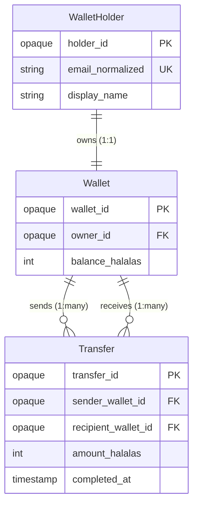

# Functional Specification: U1 Walking Skeleton

Conversation language: English.

This document is the **source of truth for workflows and state machines** in U1. The ER diagram and rules summary below are derived views of `entities.md` and `rules.md`.

Stories implemented in this unit: US1.2 (wallet setup via safety net), US1.3 (sign-in check), US2.1 (balance), US3.1 (send), US3.2 (review), US3.4 (balance check), US4.1 (history), US4.2 (received in history), US6.1 (end-to-end check on `dev`), US6.4 (opening balance).

---

## Entity-Relationship Diagram (derived from entities.md)



---

## Rules Summary (derived from rules.md)

| ID | Statement | Category |
|---|---|---|
| BR1.1 | Every money request must carry a valid, unexpired sign-in credential | Authorization |
| BR1.2 | Caller identity is taken from the credential, not a request field | Authorization |
| BR2.1 | One wallet per holder; 100,000 halalas on first request; atomic under concurrency | Policy |
| BR2.2 | Failed wallet creation leaves no partial wallet | Constraint |
| BR3.1 | Transfer is atomic: both debit and credit succeed or neither does | Constraint |
| BR3.2 | Refuse transfer when balance < amount; exact balance is accepted | Validation |
| BR3.3 | Total money across all wallets is conserved after every operation | Constraint |
| BR3.4 | Success response includes reference, new balance, recipient name | Policy |
| BR4.1 | Normalize email (trim, lowercase) before recipient lookup; safe not-found message | Validation |
| BR5.1 | History shows only own completed transfers, newest first | Authorization |
| BR5.2 | Each history entry includes name, amount, direction, timestamp | Policy |
| BR6.1 | Balance read returns only the caller's own wallet balance | Authorization |

---

## Workflows

### WF1 — Sign-in Check on Every Money Request

Applies to all MoneyApi endpoints.

1. The request arrives at MoneyApi with an Authorization header.
2. MoneyApi forwards the token to the token verifier (C5 — the edge/verifier contract).
3. **If token is invalid or expired:** return 401 Unauthorized; no wallet data is returned (BR1.1).
4. **If token is valid:** extract the caller's `holder_id` from the token claims. This `holder_id` is the only identity used for the rest of the request (BR1.2).
5. Continue to the specific endpoint workflow below.

### WF2 — Wallet Setup Safety Net

Triggered at the start of any authenticated request where the caller has no wallet yet. Applies transparently before WF3 (balance), WF5 (send), or WF6 (history).

1. After WF1 yields a valid `holder_id`, MoneyApi calls Ledger to get the caller's wallet.
2. **If Wallet exists:** proceed to the requested operation.
3. **If no Wallet exists:**
   a. Ledger attempts to create a Wallet for `holder_id` with `balance_halalas = 100,000` (BR2.1).
   b. The creation uses an atomic "insert if not exists" operation. If a concurrent request created the Wallet between step 2 and step 3a, Ledger returns the existing Wallet without creating a second one (BR2.1).
   c. **If creation succeeds:** proceed to the requested operation with the new Wallet.
   d. **If creation fails:** return a retriable 503 error. No Wallet record exists; a retry is safe (BR2.2).

### WF3 — Read Balance

**Input:** Authenticated request (WF1 → WF2 complete), `holder_id` known.

1. Ledger returns the Wallet for `holder_id`. If WF2 just ran, the Wallet is fresh with 100,000 halalas.
2. MoneyApi returns `balance_halalas` and `wallet_id` in the response (C1 §GET /wallet, BR6.1).
3. MobileApp displays the balance as `balance_halalas / 100` SAR, formatted to two decimal places (AC2.1.1).

**Balance is never zero from a missing wallet:** WF2 always ensures the Wallet exists before this step.

### WF4 — Recipient Lookup

**Input:** Authenticated request, `recipientEmail` from the caller.

1. MoneyApi normalizes `recipientEmail`: trim whitespace, then lowercase (BR4.1).
2. WalletDirectory looks up a WalletHolder by `email_normalized`.
3. **If not found:** return a not-found error. The error message must not confirm whether the address is registered (BR4.1, safe message).
4. **If found:** return `display_name` and `holder_id` to MoneyApi. MoneyApi returns `recipientEmail` (normalized), `display_name` and the opaque `recipientId` to the caller.

MobileApp uses the returned `display_name` to populate the review screen (WF5 step 2).

### WF5 — Send Transfer

This workflow has two distinct phases: a **client phase** (MobileApp) followed by a **server phase** (MoneyApi → Ledger). The break between them is the user's confirmation tap.

**Client phase — after WF4 returns a resolved recipient:**

1. MobileApp shows the review screen: recipient display name and email, amount in SAR, projected balance after transfer (`(currentBalanceHalalas - amountHalalas) / 100 SAR`) (BR3.5, AC3.2.1).
2. The user may cancel — no request is sent; no balance changes (AC3.2.2).
3. The user confirms — MobileApp disables the confirm button and calls `POST /transfers`.

**Server phase — MoneyApi receives the authenticated request:**

Input: authenticated request (WF1 → WF2 complete), `holder_id` and `wallet_id` known. The request body carries `recipientEmail` (normalized by the app), `amount_halalas`, and a unique `idempotency_key` generated by the app for this send attempt.

4. MoneyApi calls Ledger:
   a. Ledger checks: `amount_halalas <= sender.balance_halalas`. If not, refuse with an insufficient-funds error (BR3.2).
   b. Ledger atomically deducts `amount_halalas` from the sender's `balance_halalas` and adds it to the recipient's `balance_halalas`, and creates a Transfer record with `transfer_id` and `reference` (BR3.1).
   c. The total money across all wallets is unchanged (BR3.3).
5. **If Ledger succeeds:** MoneyApi returns a 201 response with `transfer_id`, `reference`, `amount_halalas`, sender's new `balance_halalas`, recipient `display_name` and `email_normalized` (BR3.4). MobileApp shows the result screen (AC3.1.2).
6. **If Ledger fails (balance check):** MoneyApi returns a 422. Both balances are unchanged; no Transfer record exists (BR3.1). MobileApp shows the insufficient-funds message; the amount and recipient remain in the form (AC3.4.1, AC3.4.3).
7. **If the atomic operation fails (server error):** MoneyApi returns 500 or 503. Neither balance changed; no Transfer record exists (BR3.1).

**Property invariant (BR3.3):** The sum of all `balance_halalas` values after any sequence of transfers equals the sum before. This is verified by the Hypothesis property test in U1's test suite.

### WF6 — View Transfer History (First Page)

**Input:** Authenticated request (WF1 → WF2 complete), `holder_id` and `wallet_id` known.

1. Ledger queries completed Transfers where `sender_wallet_id` or `recipient_wallet_id` equals the caller's `wallet_id`, ordered by `completed_at` descending.
2. For each entry, WalletDirectory provides the counterparty's `display_name` by `holder_id` (BR5.2).
3. MoneyApi returns a page of history entries. Each entry includes `transfer_id`, `reference`, `amount_halalas`, direction (`sent` or `received`), `display_name`, `email_normalized`, `completed_at` (BR5.2).
4. Only completed transfers appear. Refused or failed attempts have no Transfer record and are never shown (BR5.1, A2).
5. U1 returns the first page only. Pagination (cursor-based) is added in U2 (US4.3).
6. The caller may only see their own history (BR5.1). A request for another user's history is refused with 403.

---

## State Machines

### Wallet Lifecycle

```
[Absent] --first authenticated request--> [Creating] --success--> [Active]
                                                     --failure--> [Absent] (retry safe)
[Active] --balance unchanged between transfers
```

There is no "closed" or "suspended" state in U1. A wallet in the Active state remains active.

### Transfer Lifecycle

```
[Requested] --balance check passes, atomic write succeeds--> [Completed]
            --balance too low--> [Refused] (no record created)
            --write fails--> [Failed] (no record created)
```

A Transfer record is only created in the Completed state. Refused and Failed attempts leave no record.

---

## End-to-End Check (US6.1)

The walking skeleton is verified by two automated checks run against the deployed `dev` environment:

1. **API smoke script** — calls the deployed `dev` MoneyApi directly with two pre-created test users:
   - Test user A signs in and reads balance (should be 1,000.00 SAR).
   - Test user A looks up test user B's email.
   - Test user A sends 100.00 SAR to test user B.
   - Test user A reads balance (should be 900.00 SAR); test user B reads balance (should be 1,100.00 SAR).
   - Test user A reads history (transfer appears as "sent").
   - Test user B reads history (transfer appears as "received").

2. **Flutter integration test** — runs on an iOS simulator and an Android emulator against `dev`:
   - Signs in as test user A on the app.
   - Reads the wallet screen (balance shown).
   - Sends 100.00 SAR to test user B by email.
   - Confirms on the review screen.
   - Checks the result screen shows the reference and new balance.
   - Opens history; first entry matches the transfer.

Both checks use real sign-in, the real `dev` API, and the real data store (AC6.1.3). No mocks.

The test-user setup script creates two confirmed test users in an environment. Passwords are read from a secrets store; never from a repo or log (project rules).

---

## Assumptions & Open Questions

- The concrete AWS sign-in service and SDK implementing C3 are confirmed in U4's Infrastructure Design. U1's sign-in check depends on the token format and verifier (C5); the check is written against the C5 contract.
- The exact data store for Ledger and WalletDirectory is decided in Infrastructure Design. The functional model here is storage-agnostic.
- The test-user setup script reads passwords from a secrets store. The specific secrets manager is chosen in Infrastructure Design.

## Sources

- `unit-of-work.md` and `unit-of-work-story-map.md` in `inception/units-generation/`
- `stories.md` in `inception/user-stories/`: US1.2, US1.3, US2.1, US3.1, US3.2, US3.4, US4.1, US4.2, US6.1, US6.4
- `components.md` in `inception/domain-design/`
- `contract-summary.md` in `inception/contract-design/`: C1, C3, C5
- `entities.md` and `rules.md` in this directory
