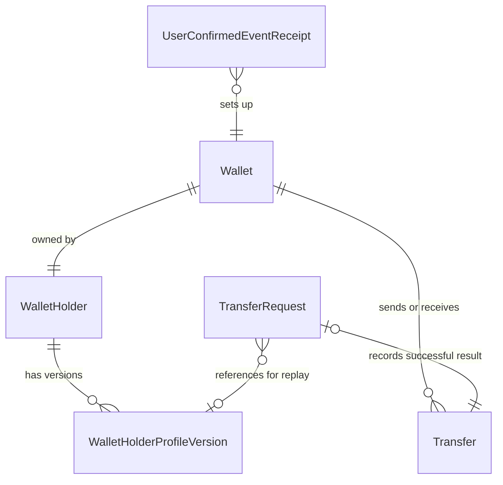

# Functional Specification — U2 Money Service

Conversation language: English.

## Scope and Stories

U2 extends `RaadMoneyService` with the remaining transfer limits and refusals, keyed replay and concurrency guarantees, stable history paging, the account-confirmed entry point, and its environment-specific service behavior. It covers the U2 parts of US1.2, US3.3, US3.5–US3.8, US4.3, and US6.2. The C1 REST API and C2 event contracts remain authoritative at the wire boundary. Mobile screens, sign-in behavior, platform rate limiting, deployment execution, and the platform's controls remain owned by U3, U4, or Operation.

## Entities and Relationships



Text equivalent: one Wallet has one WalletHolder; each Transfer connects a sender and recipient Wallet; a TransferRequest may point to its one successful Transfer; event receipts refer to the Wallet user they initialized. Successful request outcomes reference immutable WalletDirectory profile versions without copying personal fields into Ledger.

## Workflow: Wallet Setup

Entry points: authenticated `PUT /wallet` safety net and C2 `UserConfirmed` event. Both invoke the same idempotent setup operation.

1. Verify the caller/event identity and environment. A public request takes userId only from the independently verified credential and obtains email/display name from C5's configured own-profile source, checking returned subject and verified email. An event is accepted only from the same environment's authorized identity source.
2. Normalize the email for comparison. Reject malformed identity data without logging personal values.
3. Look up the wallet by verified userId. If absent, create exactly one SAR wallet with 100000 halalas using a conditional create; if present, keep its balance unchanged.
4. Register or verify the WalletHolder after the wallet is open. Enforce uniqueness of userId and normalized emailKey. A conflict with another user is an error and never merges records.
5. For C2, record eventId/userId idempotently. Duplicate or simultaneous deliveries and an overlapping `PUT /wallet` converge on the same wallet and holder.
6. Return the current wallet for `PUT /wallet`. If holder registration or required persistence fails, return a safe setup error; retry repeats the operation without another opening credit. Event consumption retries accepted events under C2 delivery rules; invalid events use dead-letter handling.

## Workflow: Recipient Lookup

1. Authenticate the request and apply the service's documented recipient-lookup guard inputs; U4 owns enforcement of the platform rate limit.
2. Normalize and validate the complete email address.
3. Compare its emailKey exactly against WalletHolder. Do not perform partial search or enumerate records.
4. If absent, return `RECIPIENT_NOT_FOUND`. If it belongs to the caller, return the self-transfer refusal. Otherwise return the single recipient's display name and canonical email for review.

## Workflow: Create or Replay a Transfer

1. Verify C5 caller identity and parse C1 request and idempotency key. Normalize recipient email and validate its complete address. Resolve the caller wallet; if it does not exist, return `WALLET_NOT_FOUND` without reserving the key so the caller can run wallet setup and retry.
2. Compute a one-way fingerprint from contract major version, normalized recipient email, and amountHalalas. Do not retain raw email in the request record.
3. Read any existing final `(verified sender userId, Idempotency-Key)` outcome. Different input returns `IDEMPOTENCY_KEY_REUSED`; identical input returns the committed first outcome. There is no separately durable reserved/pending row: conditionally create the unique pair only with its final outcome, so a killed worker cannot strand a key. Concurrent losers reread the winner with a bounded wait; unconfirmed persistence returns transient unavailable, never an invented result.
4. Apply C1 refusal precedence exactly: unknown recipient, inclusive 100–50000 halala range, own wallet, insufficient balance. Non-integer/malformed input is schema failure and consumes no key. Persist the first business refusal conditionally, without balances/history. A concurrent loser rereads the winner, never replaces its result.
5. MoneyApi first ensures an immutable recipient profile version in WalletDirectory and passes only its opaque reference to Ledger; failure returns safe unavailable without committing a transfer. For a valid transfer, atomically check the sender balance, debit sender, credit recipient, create one Transfer (UUID `transferId` plus the separate unique human-readable `reference`), and save the successful TransferRequest outcome. Insufficient funds saves a refusal outcome and changes nothing.
6. Return the saved result. A lost response can be retried with the same key and returns the original result; a new intentional transfer uses a new key. Unexpected infrastructure failures do not create a partial movement or history entry.

### Transfer reference

The API's `transferId` is the UUID machine identifier. The user-facing `reference` is separate: prefix `R-` followed by 12 uniformly generated characters from `23456789ABCDEFGHJKMNPQRSTUVWXYZ`. The data store enforces uniqueness; a collision is retried before the transfer commits. The reference contains no personal data and is returned unchanged by replay and history.

## Workflow: Stable Transfer History

1. Authenticate and derive the only allowed user identity from the verified caller.
2. On the first request, select that user's sent and received completed transfers, ordered by `completedAt` descending and `transferId` descending, using the requested `limit` (default 20, maximum 100).
3. Capture a snapshot boundary and issue an opaque authenticated cursor when more rows exist. Bind it to user, environment, limit, sort order, snapshot, and last sort key; expire the chain 24 hours after page one.
4. On a later page, verify all cursor bindings and continue strictly after the last sort key within the original snapshot. New transfers do not shift this chain. Resolve holder names for the page in a batch and return entries with direction, counterparty, amount, timestamp, and reference.
5. Reject altered, expired, wrong-user, wrong-environment, or wrong-limit cursors with `CURSOR_INVALID_OR_EXPIRED`; the client starts a fresh chain. A valid chain has no duplicate or skipped row.

## State Transitions

```text
TransferRequest: absent -> completed(result) | refused(first business outcome)
                absent -> absent (pre-commit failure; no durable reservation)
Transfer:       absent -> completed (only in same atomic commit as both balance changes)
Wallet:         absent -> open(100000 halalas) -> open(current balance)
Event receipt:  absent -> processed; duplicate event/user -> no-op
```

No partially completed Transfer is visible. A stored refusal is immutable for its key; a failed transport does not change the first outcome.

## Environment and Verification Behavior

The service is configured for exactly one environment (`dev`, `stg`, or `prd`) and accepts only the matching C2 event, C5 identity configuration, and store. U2 supplies environment-specific service stacks and a smoke check; provisioning and running all three environments are later Operation work. A service smoke check validates health and the C1 wallet, balance, transfer, and history path using only designated test identities and simulated SAR; it never uses real payment rails.

## Consistency and Response Ownership

The canonical Transfer references senderWalletId and recipientWalletId, never user IDs as substitutes for wallet identity. Ledger outcomes retain the original non-personal business result including balanceAfter and only an opaque recipientProfileVersionId. WalletDirectory owns the durable immutable profile version containing the original recipient email/name. MoneyApi reconstructs the original recipient object by authorized version lookup; current-profile changes cannot alter replay. No recipient fields enter Ledger, its outcomes, canonical Transfer rows, fingerprints or logs. Retain referenced versions for the outcome lifetime; missing/corrupt version data fails replay safely with unavailable and investigation, never recomputation from a current profile or another financial write. A version is ensured before the outcome is prepared; an unused version after pre-commit failure is not a transfer. Correlation IDs are fresh per response. Final keys/outcomes remain for the environment lifetime. Infrastructure Design must prove stable history reads: an eventual index query alone cannot prove snapshot completeness or no omissions. Preserve U1 balances/transfer IDs when adding indexes; historical U1 requests gain no fabricated replay outcomes.

## Rules Summary

Rules BR2.1–BR2.12 in `rules.md` govern owner-derived wallet setup, holder uniqueness, normalized exact lookup, amount validation, atomic balance movement, request replay, references, stable history, event deduplication, and data minimization.

## Sources

- `stories.md`: US1.2, US3.3, US3.5–US3.8, US4.3, US6.2 and their acceptance criteria.
- `requirements.md`: FR1.5–FR1.6, FR3.1–FR3.12, FR5.3, FR7.1, NFR3–NFR4, NFR10–NFR11.
- `unit-of-work.md` and `unit-of-work-story-map.md`: U2 responsibility and story allocation.
- `components.md`: MoneyApi, Ledger, WalletDirectory, wallet setup sequence and data ownership.
- `contract-summary.md`: C1 API, C2 event behavior, C5 verified caller identity, and the accepted cursor and idempotency semantics.
- `functional-design-questions.md`: Q1 answer B, short human-readable user reference separate from the UUID.
