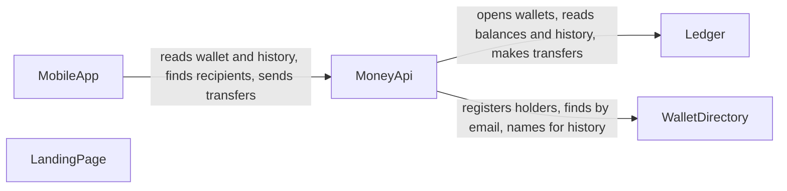
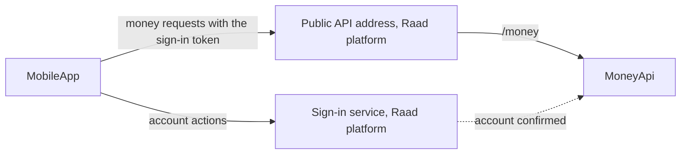

# Components: RAAD Digital Wallet MVP

Conversation language: English.

This catalogue names the building blocks of RAAD, meaning the code the team writes, and says which block owns which data. It follows the answers in `domain-design-questions.md`: the wallet opens at confirmation with a safety net (Q1 B and Q6 A), the money service has three blocks (Q2 A), the shared platform is infrastructure (Q3 A), names are looked up when history is read (Q4 A), and nothing is announced on the event bus in the MVP (Q5 A). It realizes the stories in `stories.md` and the requirements in `requirements.md`, serves the screens in `mockups.md`, and keeps to `team-practices.md`.

Infrastructure appears only as external dependencies: the shared platform in `Raad` (sign-in service, public API address, firewall and rate limits, event bus), the data stores and the web hosting. This stage does not decide how the blocks are grouped into deployable units (Units Generation), or the technology and NFR patterns (later stages). Entities are given as ownership and attribute names only; types and validation come in Functional Design. The decisions behind the boundaries are in `decisions.md` (ADR-001 to ADR-007).

## Component Catalogue

```yaml
components:
  - name: MobileApp
    summary: "The Flutter app for iOS and Android: every screen a Wallet User sees, in Arabic and English."
    behaviour: >
      Shows screens S1 to S11 of mockups.md in Arabic (right to left) and English, with no
      push notifications and no automatic refresh. Sends every account action (sign-up,
      confirmation, code resend, sign-in, sign-out, session renewal and password reset)
      straight to the sign-in service, so passwords never reach the money service (ADR-007).
      Sends every money request to MoneyApi with the user's sign-in token and never sends a
      user id or wallet id of its own choosing. Makes one new request key for each transfer
      at the first Confirm, keeps it with the PendingTransfer, reuses it only to retry the
      same locked details after a lost answer, and drops it when the details change or the
      user leaves the flow. Checks the amount range (1.00 to 500.00 SAR) and the user's own
      address before sending only to save a round trip; MoneyApi and Ledger remain the
      authority. Turns sending off while offline and shows the last BalanceSnapshot marked
      out of date when a refresh fails. Keeps sign-in tokens only in the phone's secure
      storage and never stores the password.
    responsibilities:
      - "All screens, states and messages of the wallet app (S1 to S11)"
      - "Language choice and the mirrored Arabic layout"
      - "Request keys and the pending-transfer state after a lost answer"
      - "The last known balance for offline display"
    depends_on:
      - component: MoneyApi
        interaction: "Reads the wallet and history, looks up a recipient for the review screen, sends transfers"
        style: sync
    dependents: []
    external_dependencies:
      - name: "Sign-in service (shared user pool in the Raad platform)"
        kind: other
        purpose: "Sign-up, confirmation code and resend, sign-in, sign-out, session renewal, password reset"
      - name: "Public API address (Raad platform)"
        kind: other
        purpose: "The one address the app calls; its /money path reaches MoneyApi"
      - name: "Phone secure storage"
        kind: other
        purpose: "Sign-in tokens"
      - name: "Phone local storage"
        kind: database
        purpose: "PendingTransfer, BalanceSnapshot and LanguageSetting"
    entities:
      - name: PendingTransfer
        identifier: requestKey
        attributes: [requestKey, recipientEmail, amount, state, createdAt]
        references:
          - entity: TransferRequest
            owned_by: Ledger
            relationship: "once sent, a pending transfer's key names exactly one TransferRequest"
      - name: BalanceSnapshot
        identifier: userId
        attributes: [userId, balance, updatedAt]
        references:
          - entity: Wallet
            owned_by: Ledger
            relationship: "a snapshot is the last balance the app received for the signed-in user's wallet"
      - name: LanguageSetting
        identifier: installId
        attributes: [installId, language]

  - name: MoneyApi
    summary: "The only way into the money service: checks every caller and request, and combines Ledger and WalletDirectory for each use case."
    behaviour: >
      Accepts app requests only through the public API address, checks each one against the
      money service's API description and refuses anything that does not match it. Every app
      request needs a valid sign-in. The caller is the user id in the verified sign-in, never a
      value in the request, so a user can reach only their own wallet and history. Runs one
      wallet-setup procedure that is safe to repeat for the same user (ADR-003): it opens the
      wallet in Ledger first, then registers the holder in WalletDirectory with the email and
      display name from the verified sign-in. The procedure runs when the sign-in service
      signals that an account was confirmed, through an entry point that only the sign-in
      service can call and that is not reachable through the public API address. It runs
      again, as the safety net, whenever a signed-in caller has no WalletDirectory entry yet.
      A failed setup never makes the confirmation fail; it is logged and completed on the
      user's next request. To send, it finds the recipient by email in WalletDirectory (no
      match gives the refusal that no RAAD user has this email address), then asks Ledger to
      transfer from the caller's wallet with the request key, and returns Ledger's outcome
      unchanged. For the review screen it returns the recipient's display name and email for an
      exact address match. For a history page it reads the page from Ledger and adds the other
      party's name and email from WalletDirectory in one batch. Every refusal returns a stable
      code and a message safe to show, with no internal detail. Logs carry an opaque user id
      and a correlation id, and never an email address, password or token. Publishes nothing
      on the event bus in the MVP (ADR-005).
    responsibilities:
      - "Caller and request checks for the money service"
      - "Wallet setup at confirmation and as the safety net on a later request"
      - "Combining Ledger and WalletDirectory for balance, review, send and history"
      - "Safe error responses and logs free of personal data"
    depends_on:
      - component: Ledger
        interaction: "Opens wallets, reads balances and history pages, makes transfers"
        style: sync
      - component: WalletDirectory
        interaction: "Registers holders, finds a recipient by email, resolves names for a history page"
        style: sync
    dependents:
      - component: MobileApp
        interaction: "Wallet, history, recipient lookup and transfers"
    external_dependencies:
      - name: "Sign-in service (shared user pool in the Raad platform)"
        kind: other
        purpose: "Verifies each caller's sign-in, and signals MoneyApi when an account is confirmed"
      - name: "Public API address, firewall and rate limits (Raad platform)"
        kind: other
        purpose: "Routes /money requests to MoneyApi and limits requests per caller"
    entities: []

  - name: Ledger
    summary: "The money core: wallets, balances, transfers and request keys. The only block that changes a balance."
    behaviour: >
      Holds every amount as whole halalas. Opens at most one wallet per owner: the first
      opening credits the opening balance of 100,000 halalas (1,000.00 SAR) in every
      environment, and opening again for the same owner returns the same wallet and credits
      nothing. A transfer is refused unless the amount is from 100 to 50,000 halalas inclusive,
      the two wallets differ, and the sender's balance covers the amount at the moment of the
      change. The balance check, both balance changes, the TransferRequest and the Transfer are
      one all-or-nothing change, so a failure changes nothing and simultaneous transfers can
      never take a balance below zero (ADR-006). Each sender and request key is answered once:
      a repeat with the same details returns the first outcome, completed or refused, without
      running the rules again, and a repeat with different details is refused. Each completed
      transfer gets a reference that is unique among all transfers. History returns only
      completed transfers in which the wallet is the sender or the recipient, newest first with
      a fixed tiebreak, one page at a time from a position marker, so no entry is skipped or
      shown twice when new transfers arrive. At all times the sum of all balances equals the
      sum of all opening balances, and no balance is below zero. Holds no personal data;
      wallets are linked to people only by the opaque user id. Built test-first, with at least
      95% line and branch coverage (team practices).
    responsibilities:
      - "Wallets and their balances"
      - "Transfer rules: amount limits, not to one's own wallet, enough balance, all or nothing"
      - "Request keys and their first outcome"
      - "Transfer references and the history of completed transfers"
    depends_on: []
    dependents:
      - component: MoneyApi
        interaction: "Opens wallets, reads balances and history pages, makes transfers"
    external_dependencies:
      - name: "Ledger data store (chosen in infrastructure design)"
        kind: database
        purpose: "Wallets, TransferRequests and Transfers, changed all or nothing"
    entities:
      - name: Wallet
        identifier: walletId
        attributes: [walletId, ownerId, balance, openingBalance, openedAt]
        references:
          - entity: WalletHolder
            owned_by: WalletDirectory
            relationship: "each wallet belongs to one wallet holder, matched by the holder's user id"
      - name: TransferRequest
        identifier: "senderWalletId + requestKey"
        attributes: [senderWalletId, requestKey, recipientWalletId, amount, outcome, transferId, receivedAt]
      - name: Transfer
        identifier: transferId
        attributes: [transferId, reference, senderWalletId, recipientWalletId, amount, completedAt]

  - name: WalletDirectory
    summary: "Who each wallet holder is: email address and display name, and finding a holder by email."
    behaviour: >
      Holds the only personal data in the money service: each holder's email address and
      display name, copied once from the verified sign-in at wallet setup. The sign-in service
      stays the source of truth; the MVP offers no way to change either value, so the copy
      cannot go stale. One holder per user id, and one user id per email address. Email
      addresses are compared after removing surrounding spaces and ignoring capital letters,
      and the address as typed is kept for display. If an address is already held by a
      different user id, registration is refused and reported as an error, never merged. A
      lookup by email returns at most one holder, and only for an exact match of the whole
      address, with no partial match, listing or search. A lookup of many user ids at once
      serves a history page. MoneyApi registers a holder only after the holder's wallet is
      open, so a holder found by email always has a wallet (ADR-003).
    responsibilities:
      - "Email address and display name of each wallet holder"
      - "Finding a recipient by email address"
      - "Names and emails for a history page"
    depends_on: []
    dependents:
      - component: MoneyApi
        interaction: "Registers holders, finds a recipient by email, resolves names for a history page"
    external_dependencies:
      - name: "Directory data store (chosen in infrastructure design)"
        kind: database
        purpose: "WalletHolder records"
    entities:
      - name: WalletHolder
        identifier: userId
        attributes: [userId, email, emailKey, displayName, registeredAt]

  - name: LandingPage
    summary: "The public RAAD page in Arabic and English, with a link to request test access."
    behaviour: >
      A static page (S12 in mockups.md) with the RAAD name, a short description and a
      Request test access button that opens an email to the team's address. Switches between
      Arabic (right to left) and English. Calls no other block and no sign-in, holds no data
      and shows no wallet information.
    responsibilities:
      - "The public introduction to RAAD"
    depends_on: []
    dependents: []
    external_dependencies:
      - name: "Static site hosting (S3 and CloudFront, set by the team practices)"
        kind: object-store
        purpose: "Serves the page over HTTPS in each environment"
    entities: []
```

## Component Diagram



Text fallback: MobileApp calls MoneyApi. MoneyApi calls Ledger and WalletDirectory. Ledger, WalletDirectory and LandingPage call no other block. Every call is synchronous, and there are no cycles.

### With the platform around it



Text fallback: the app sends account actions (sign-up, confirmation, sign-in, password reset) straight to the sign-in service, and money requests to the public API address, which routes the `/money` path to MoneyApi. When an account is confirmed, the sign-in service signals MoneyApi, which opens the wallet (ADR-003).

## Component Summary

| Component | Purpose | Depends On | Dependents | Entities Owned |
|---|---|---|---|---|
| MobileApp | Every screen of the wallet app, in Arabic and English | MoneyApi | none | PendingTransfer, BalanceSnapshot, LanguageSetting |
| MoneyApi | The only way into the money service; checks callers and requests and combines the two blocks below | Ledger, WalletDirectory | MobileApp | none |
| Ledger | Wallets, balances, transfers and request keys; the only block that changes a balance | none | MoneyApi | Wallet, TransferRequest, Transfer |
| WalletDirectory | Email and display name of each holder; finding a holder by email | none | MoneyApi | WalletHolder |
| LandingPage | The public RAAD page | none | none | none |

## Entity Ownership

| Entity | Owning Component | Identifier | Attributes | References |
|---|---|---|---|---|
| PendingTransfer | MobileApp | requestKey | requestKey, recipientEmail, amount, state, createdAt | TransferRequest (Ledger) |
| BalanceSnapshot | MobileApp | userId | userId, balance, updatedAt | Wallet (Ledger) |
| LanguageSetting | MobileApp | installId | installId, language | none |
| Wallet | Ledger | walletId | walletId, ownerId, balance, openingBalance, openedAt | WalletHolder (WalletDirectory), by user id |
| TransferRequest | Ledger | senderWalletId + requestKey | senderWalletId, requestKey, recipientWalletId, amount, outcome, transferId, receivedAt | none (Transfer is in the same block) |
| Transfer | Ledger | transferId | transferId, reference, senderWalletId, recipientWalletId, amount, completedAt | none |
| WalletHolder | WalletDirectory | userId | userId, email, emailKey, displayName, registeredAt | none (userId is the sign-in service's id) |

Each entity has exactly one owner. `TransferRequest` holds every request key and its first outcome, including refusals. `Transfer` holds only completed movements, and the history reads `Transfer` alone, so a refused request can never appear in it (FR5.4).

## External Dependencies

| Component | Dependency | Kind | Purpose |
|---|---|---|---|
| MobileApp | Sign-in service (Raad platform) | other | All account actions |
| MobileApp | Public API address (Raad platform) | other | Reaching MoneyApi |
| MobileApp | Phone secure storage | other | Sign-in tokens |
| MobileApp | Phone local storage | database | PendingTransfer, BalanceSnapshot, LanguageSetting |
| MoneyApi | Sign-in service (Raad platform) | other | Verifying callers; the account-confirmed signal |
| MoneyApi | Public API address, firewall and rate limits (Raad platform) | other | Routing `/money`; limits per caller |
| Ledger | Ledger data store | database | Wallets, TransferRequests, Transfers |
| WalletDirectory | Directory data store | database | WalletHolders |
| LandingPage | Static site hosting (S3 and CloudFront) | object-store | Serving the page |

Ledger and WalletDirectory each own their own data, and neither reads or writes the other's. Whether the two stores are one physical database with separate tables or two databases is decided in infrastructure design. The platform's event bus is not used by any block in the MVP (ADR-005).

## Key Flows

### Wallet setup (FR1.5, AC1.2.3 to AC1.2.5)

1. The sign-in service confirms the account and signals MoneyApi with the user id, email address and display name.
2. MoneyApi asks Ledger to open a wallet for that user id. Ledger opens it with 100,000 halalas, or returns the existing wallet and credits nothing.
3. MoneyApi registers the holder in WalletDirectory.
4. If step 2 or 3 fails, the confirmation still succeeds for the user and the failure is logged. On the user's next signed-in request, MoneyApi finds no holder entry and runs steps 2 and 3 again with the email and display name from the verified sign-in. If that also fails, the app shows "We could not set up your wallet" with **Try again**, and the retry runs the same safe procedure (AC1.2.5).

### Send money (US3.1 to US3.8)

1. Review: MobileApp asks MoneyApi for the recipient by email. MoneyApi asks WalletDirectory. An exact match returns the name and email for screen S8; otherwise the refusal says no RAAD user has this address.
2. Confirm: MobileApp sends the recipient's email, the amount and the request key. MoneyApi finds the recipient again by email (the app never sends a wallet id), then asks Ledger to transfer from the caller's wallet to the recipient's wallet with the key.
3. Ledger checks the rules and makes the change all or nothing, or returns the first outcome for a key it has seen.
4. MoneyApi returns the outcome, and MobileApp shows screen S9.

### History page (US4.1, US4.3)

1. MobileApp asks MoneyApi for the first page, or for the next page after a position marker.
2. MoneyApi asks Ledger for that page of the caller's completed transfers.
3. MoneyApi asks WalletDirectory for the other parties' names and emails in one batch, and returns the page.

## Rationale

| Component | Why it is a separate building block |
|---|---|
| MobileApp | It runs on the phone, has its own repo and release path (TestFlight and Google Play internal testing) and owns on-device state. Nothing else shares its code or data. |
| MoneyApi | It carries the concerns that change with the API: caller checks, request checks, combining the blocks and safe errors. Keeping them here leaves Ledger free of web and identity code so it can be tested alone. |
| Ledger | It owns the money data and the strictest rules, and it changes rarely and only test-first. Keeping it small keeps the 95% coverage floor and the money-movement tests on one block. The all-or-nothing transfer touches only its own data. |
| WalletDirectory | It owns personal data and its own rules (comparing addresses, exact lookup only). It is the privacy boundary that keeps personal data out of the Ledger. |
| LandingPage | It is code the team writes (HTML and CSS) with its own repo, lifecycle and audience, public web visitors. It shares no code or data with the app. The shared platform is not a block because it is infrastructure configuration with no business rules (Q3 A, ADR-004). |

### Component-boundary options

**How to split the money service (Q2)**

- Option A, three blocks (MoneyApi, Ledger, WalletDirectory). Pros: the strictest rules sit on a small Ledger; personal data sits in one block; the transfer changes only one block's data. Cons: MoneyApi makes two calls for a send and for a history page; opening a wallet touches two blocks. Reversibility: easy to merge later, since all three live in one repo.
- Option B, one WalletService block. Pros: the fewest moving parts. Cons: money rules, personal data and web concerns mix; the coverage floor covers everything or relies on an unnamed inner line. Reversibility: harder to split once tests and data mix.
- Option C, two blocks with names and emails stored in each ledger entry. Pros: one read per history page. Cons: personal data sits in the money core and is copied into every transfer. Reversibility: hard, because the copies live on in the history.
- **Chosen: Option A (Q2).** Alternatives rejected: B and C, for the reasons above (ADR-001).

**Who opens the wallet (Q1 and Q6)**

- Option A, the money service on the app's first request only. Pros: one trigger, inside one service. Cons: the wallet does not exist until the user signs in.
- Option B, the sign-in service at confirmation only. Pros: the wallet exists before the first sign-in. Cons: a failed opening leaves a confirmed user with no wallet and nothing to retry, which breaks AC1.2.5.
- Option B with a safety net on the first request. Pros: the wallet usually exists early, and any failure heals on the next request. Cons: two entry points to secure and test.
- **Chosen: Option B with the safety net (Q1 B, Q6 A).** Alternatives rejected: A alone, which the person did not choose, and B alone, because of AC1.2.5. A background retry (Q6 B) was also rejected (ADR-003).

## Assumptions & Open Questions

- **How the confirmation signal is wired.** The sign-in service lives in `Raad`, MoneyApi in `RaadMoneyService`, and the practices deploy `Raad` first. How the account-confirmed signal reaches MoneyApi without making `Raad` depend on the money service at deploy time is decided in infrastructure design. The safety net keeps the flow correct while the signal is missing or failing.
- **Email and display name on the safety-net path.** MoneyApi takes them from the verified sign-in, never from the request body. Contract Design decides how they reach MoneyApi, for example carried in the sign-in token.
- **A recipient whose setup failed.** A confirmed user whose setup failed and who has not opened the app since has no holder entry, so a sender is told no RAAD user has that address until the recipient's next signed-in request completes setup. This is accepted for the MVP; with the confirmation signal working, the window is rare.
- **Transfer reference format.** Ledger issues the reference; its exact format is set in Functional Design.
- **Data stores.** The technology, and whether Ledger and WalletDirectory share one physical store, are decided in infrastructure design. The Ledger's store must support an all-or-nothing change across several records with a balance condition (ADR-006).
- **Later services.** The AI assistant and Qattah are not modelled. They attach through the platform's path mapping and reach money only through MoneyApi (NFR13, team practices).

## Sources

- `requirements.md` in `inception/requirements-analysis/`: FR1 to FR8, NFR1 to NFR15, assumptions A1 to A13.
- `stories.md` in `inception/user-stories/`: US1.1 to US6.4 and their acceptance criteria, including AC1.2.6.
- `mockups.md` and `interaction-spec.md` in `inception/refined-mockups/`: screens S1 to S12 and the transfer retry rules.
- `team-practices.md` in `inception/practices-discovery/`: the repos, the rule that only `RaadMoneyService` changes balances, the test-first money core and the deployment order.
- `domain-design-questions.md` in this stage's directory: the answers to Q1 to Q6.
