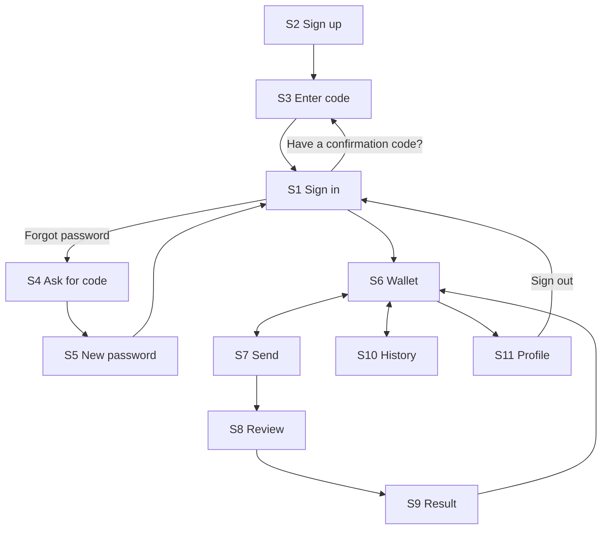

# Mockups: RAAD Digital Wallet MVP

Conversation language: English.

The screens below are drawn as text so they can be reviewed and versioned beside the stories. They show structure, content and states at the level a developer needs to build from; colours, type and spacing come from `design-system-mapping.md`, and behaviour from `interaction-spec.md`. Each screen names the stories it serves (`US1.1` to `US6.4` in `stories.md`). The design follows the answers in `refined-mockups-questions.md` (Q1 to Q9) and the requirements in `requirements.md`. The classic plan has no rough-mockups stage, so these are designed directly from the stories and requirements.

## Design Direction

The person supplied the RAAD logo (Q1): a chrome lightning bolt beside the Arabic "رعد" and the Latin "RAAD", on black, with blue and warm glints. The app takes its look from it; the colours are proposed from how the image looks and are to be checked against the original file (see Logo Use).

- **Dark theme.** The logo is drawn on black, so the app uses one dark theme in the MVP. A light theme is not designed (see Open Questions).
- **Chrome and electric blue.** Text and the logo are silver-white; the one accent colour is the logo's electric blue, used for the main button, links and focus. Warm peach appears only as a highlight on the balance card edge.
- **Calm and exact.** Money screens show few things at once: one balance, one main action, one clear result.
- **Arabic and English as equals.** Every screen is drawn left to right in English; in Arabic the whole layout mirrors (US5.1). The bolt symbol never mirrors.

## Logo Use

| Place | Which part of the logo | Size |
|---|---|---|
| Sign-in, sign-up and confirm-code screens | Full lockup (bolt, "رعد", "RAAD") | 160 dp wide, centred |
| Wallet screen top bar | Bolt mark alone, 28 dp | Start side of the bar |
| App icon | Bolt mark alone, centred on the dark background colour | Platform sizes |
| Landing page | Full lockup | 240 px wide |

The logo reached the design only as an image shown in the chat; no file could be found on disk. The description of the logo and the colours in this design are therefore taken from how the image looks (near-black ground, silver-white chrome, an electric-blue glint, a warm peach glint). They are proposals to check against the real file, not measurements taken from it. The app and the page need a version with a transparent background (a PNG or SVG) of the full lockup and of the bolt on its own. The original is to be kept at `inception/refined-mockups/assets/raad-logo.png`; that copy is still to be added (see Open Questions), and the theme is not final until it is.

## Screen Inventory

| ID | Screen | Stories |
|---|---|---|
| S1 | Sign in | US1.3, US1.6 |
| S2 | Sign up | US1.1 |
| S3 | Enter confirmation code | US1.2, AC1.3.3 |
| S4 | Forgot password: ask for a code | US1.5 |
| S5 | Forgot password: new password | US1.5 |
| S6 | Wallet (balance and latest transfers) | US2.1, US2.2, US4.2, US5.3 |
| S7 | Send: recipient and amount | US3.1, US3.3, US3.4, US3.5, US3.9 |
| S8 | Send: review and confirm | US3.2, US3.6 |
| S9 | Send: result | US3.1, US3.8 |
| S10 | History | US4.1, US4.2, US4.3, US4.4, US5.3 |
| S11 | Profile (language, sign out) | US1.4, US5.1 |
| S12 | Landing page (web) | US6.3 |

Navigation: after sign-in the user sees a bottom tab bar with three tabs: **Wallet** (S6), **Send** (S7 to S9) and **History** (S10). A profile icon at the start of the Wallet top bar opens S11 (Q2, answer A). S1 to S5 are outside the tab bar.

## Navigation Map



Text fallback: S2 leads to S3, which leads to S1. S1 reaches S3 (confirmation code link), S4 (forgot password, which leads to S5 and back to S1), or S6 (signed in). From S6 the tabs reach S7 and S10; S7 leads to S8 and S9 and back to S6; S6 opens S11, whose sign-out returns to S1.

---

## S1 Sign in

Stories: US1.3, US1.6. Requirements: FR1.3, FR1.4.

```
┌──────────────────────────────────┐
│            [ ⚡ رعد  RAAD ]        │  lockup, 160 dp
│                                  │
│  Sign in                         │  title
│                                  │
│  Email address                   │  label above field
│  ┌────────────────────────────┐  │
│  │ name@example.com           │  │
│  └────────────────────────────┘  │
│  Password                        │
│  ┌────────────────────────────┐  │
│  │ ••••••••                👁 │  │  show/hide toggle
│  └────────────────────────────┘  │
│                  Forgot password?│  link
│                                  │
│  ┌────────────────────────────┐  │
│  │          Sign in           │  │  primary, 48 dp
│  └────────────────────────────┘  │
│                                  │
│  New to RAAD?  Create an account │
│  Have a confirmation code?       │  links (Q5, answer A)
│                         [ DEV ]  │  environment chip, not shown in prd
└──────────────────────────────────┘
```

| State | What the user sees |
|---|---|
| Default | Empty fields, Sign in button on. |
| Loading | Button shows a spinner and the label "Signing in…"; fields are off. |
| Refused (AC1.3.2, AC1.3.3) | One message under the title with an error icon: "The email address or password is not correct." The same text for a wrong password, an unknown email and an unconfirmed account. Typed email stays. |
| Too many attempts (AC1.3.5) | "Too many attempts. Please wait a few minutes and try again." Button is off for the wait shown by the service. |
| Offline | Banner at the top: "No connection. Check your network and try again." Button is off. |
| Session ended (US1.6) | This screen with the note "For your security, please sign in again." |

## S2 Sign up

Stories: US1.1. Requirements: FR1.1, FR1.6, NFR11.

```
┌──────────────────────────────────┐
│ ←                                │
│  Create your account             │
│                                  │
│  Display name                    │
│  ┌────────────────────────────┐  │
│  │                            │  │
│  └────────────────────────────┘  │
│  Email address                   │
│  ┌────────────────────────────┐  │
│  │                            │  │
│  └────────────────────────────┘  │
│  Password                        │
│  ┌────────────────────────────┐  │
│  │                         👁 │  │
│  └────────────────────────────┘  │
│  At least 8 characters, with a   │
│  lower-case letter, an upper-    │
│  case letter and a digit.        │  rule always visible, not only on error
│                                  │
│  ┌────────────────────────────┐  │
│  │       Create account       │  │
│  └────────────────────────────┘  │
└──────────────────────────────────┘
```

| State | What the user sees |
|---|---|
| Field error (AC1.1.3) | Under the password: "The password needs at least 8 characters, a lower-case letter, an upper-case letter and a digit." All typed values stay. Checked when the user leaves the field. |
| Address in use (AC1.1.2) | Under the email: "This email address is already in use. Sign in instead?" with a link to S1. |
| Success | Goes to S3 with the email filled in. |
| Loading, offline | As S1. |

## S3 Enter confirmation code

Stories: US1.2, and AC1.3.3 (reachable from S1 for any email address).

```
┌──────────────────────────────────┐
│ ←                                │
│  Confirm your email              │
│  We sent a code to your email    │
│  address. Enter it below.        │
│                                  │
│  Email address                   │
│  ┌────────────────────────────┐  │
│  │ name@example.com           │  │  filled in when coming from S2
│  └────────────────────────────┘  │
│  Confirmation code               │
│  ┌────────────────────────────┐  │
│  │ 123456                     │  │  numeric keypad, autofill from SMS/email
│  └────────────────────────────┘  │
│                                  │
│  ┌────────────────────────────┐  │
│  │          Confirm           │  │
│  └────────────────────────────┘  │
│  Send the code again             │  link, added on the person's instruction
└──────────────────────────────────┘
```

Q5 answer A had no resend option. At the gate the person asked for all review findings to be fixed, and the product lead's first finding was that an expired code left a dead end, so the "Send the code again" link (Q5 answer B) is added. It needs the email field to be filled in.

| State | What the user sees |
|---|---|
| Wrong or expired code (AC1.2.2) | Under the code: "This code is not valid. Check it and try again." The email and code stay. |
| Resend | **Send the code again** emails a new code to the address in the field and the line "We sent a new code." appears. The old code stops working. If the address is not registered or is already confirmed, the same line appears and nothing is sent, so the screen does not reveal which addresses exist. Resends are limited by the same rate limit as sign-in (AC1.3.5); when it applies, the line is "Too many attempts. Please wait a few minutes." |
| Success | Goes to S1 with the note "Your email is confirmed. Please sign in." On the first sign-in the wallet is created (AC1.2.3). |
| Wallet creation failed (AC1.2.5) | After signing in, a screen with the title "We could not set up your wallet", the sentence "Nothing was lost. Please try again." and a **Try again** button. No tab bar. |

## S4 Forgot password: ask for a code

Stories: US1.5.

```
┌──────────────────────────────────┐
│ ←                                │
│  Reset your password             │
│  Enter your email address and    │
│  we will send you a code.        │
│  Email address                   │
│  ┌────────────────────────────┐  │
│  └────────────────────────────┘  │
│  ┌────────────────────────────┐  │
│  │         Send code          │  │
│  └────────────────────────────┘  │
└──────────────────────────────────┘
```

After the button the screen goes to S5 and always says "If an account exists for this address, we sent a code." This keeps the screen from confirming whether an address is registered.

## S5 Forgot password: new password

Stories: US1.5.

```
┌──────────────────────────────────┐
│ ←                                │
│  Choose a new password           │
│  Code                            │
│  ┌────────────────────────────┐  │
│  └────────────────────────────┘  │
│  New password                    │
│  ┌────────────────────────────┐  │
│  │                         👁 │  │
│  └────────────────────────────┘  │
│  At least 8 characters, with a   │
│  lower-case letter, an upper-    │
│  case letter and a digit.        │
│  ┌────────────────────────────┐  │
│  │      Change password       │  │
│  └────────────────────────────┘  │
└──────────────────────────────────┘
```

Wrong or expired code (AC1.5.2): "This code is not valid. Check it and try again." Rule broken (AC1.5.3): the same rule text as S2. Success goes to S1 with "Your password was changed. Please sign in."

## S6 Wallet

Stories: US2.1, US2.2, US4.2, US5.3. Requirements: FR2.1, FR2.3, FR4.1, FR6.2.

```
┌──────────────────────────────────┐
│ (👤) ⚡                        ⟳ │  profile icon, bolt mark, Refresh button
│                                  │
│ ┌──────────────────────────────┐ │
│ │ Balance                      │ │  card, warm edge highlight
│ │ 1,234.56 SAR                 │ │  large, tabular figures
│ │ Updated just now             │ │
│ └──────────────────────────────┘ │
│ ┌──────────────────────────────┐ │
│ │        Send money            │ │  primary, 48 dp
│ └──────────────────────────────┘ │
│                                  │
│ Latest transfers        See all  │
│ ↑ Sent to Khalid                 │
│   a@x.com        −100.00 SAR     │
│   11 Nov 2026, 14:05             │
│ ↓ Received from Noura            │
│   b@x.com        +50.00 SAR      │
│   10 Nov 2026, 09:30             │
│  …(up to 5)                      │
│                                  │
│ [ Wallet ]   [ Send ]  [ History ]│  tab bar
└──────────────────────────────────┘
```

Pull down to refresh, or press the **Refresh** button (⟳, 44 dp, labelled "Refresh" for screen readers) at the end of the top bar (AC4.2.1). The button is always visible, so a person using a screen reader or switch access can refresh without the pull gesture. Sent and received entries differ by arrow icon, the words "Sent to" or "Received from", and the sign on the amount, never by colour alone (AC5.2.3). Received amounts use the success colour, sent amounts use the primary text colour.

| State | What the user sees |
|---|---|
| Loading (first load) | The card and five list rows as grey placeholder shapes. |
| Loaded | As drawn. |
| Out of date (AC2.2.1) | The card shows the old balance and, in the warning colour with a clock icon: "Out of date. Last updated 14:05." A **Try again** link sits beside it. |
| Error, never loaded (AC2.2.2) | The card is replaced by: "We could not load your balance." and a **Try again** button. No zero is shown. |
| No transfers | Under "Latest transfers": "No transfers yet." (as S10). |
| Refreshing | A spinner at the top while pulling; the old figures stay until the new ones arrive. |
| Offline | The "Out of date" state, plus the Send button turns off with the line "Sending needs a connection." |

## S7 Send: recipient and amount

Stories: US3.1, US3.3, US3.4, US3.5, US3.9. Requirements: FR3.1, FR3.2, FR3.5, FR3.6, FR3.12.

```
┌──────────────────────────────────┐
│ ←  Send money                    │
│                                  │
│  Your balance: 1,234.56 SAR      │
│                                  │
│  Recipient's email address       │
│  ┌────────────────────────────┐  │
│  │ name@example.com           │  │
│  └────────────────────────────┘  │
│  Amount (SAR)                    │
│  ┌────────────────────────────┐  │
│  │                  100.00    │  │  digits fill from the right
│  └────────────────────────────┘  │
│  From 1.00 to 500.00 SAR         │  hint, always visible
│                                  │
│  ┌────────────────────────────┐  │
│  │          Continue          │  │
│  └────────────────────────────┘  │
│                                  │
│ [ Wallet ]   [ Send ]  [ History ]│
└──────────────────────────────────┘
```

The amount field takes digits only and fills from the right, so 1, 0, 0, 0, 0 reads 1.00, 10.00, 100.00 (calculator style). This makes an amount with a fraction of a halala impossible to type; the service still checks it (AC3.3.2). The value is held in whole halalas.

| State | What the user sees |
|---|---|
| Continue is off | Until the email looks like an address and the amount is between 1.00 and 500.00 SAR. |
| Amount too low or too high (AC3.3.2) | Under the amount: "The amount must be between 1.00 and 500.00 SAR." |
| Balance too low (AC3.4.1) | Under the amount, shown when the user presses Continue and again if the service refuses: "Your balance is too low for this transfer." The service is the authority; the app checks first only to save a trip. |
| Own address (AC3.5.2) | Under the email: "You cannot send money to yourself." |
| Unknown recipient (AC3.5.1) | Shown after Continue, under the email: "No RAAD user has this email address." |
| Too many lookups (AC3.5.4) | "Too many attempts. Please wait a few minutes." |
| Offline (AC3.9.1) | The Continue button is off and the line "Sending needs a connection." sits above it. When the connection returns it turns on without leaving the screen (AC3.9.2). |
| Any refusal | Everything the user typed stays in the fields (AC3.3.4, AC3.4.3). |

## S8 Send: review and confirm

Stories: US3.2, US3.6. Requirements: FR3.3, FR3.7, FR3.9.

```
┌──────────────────────────────────┐
│ ←  Review transfer               │
│                                  │
│  You are sending                 │
│       100.00 SAR                 │  large
│  to                              │
│       Khalid Al-Qahtani          │
│       khalid@example.com         │
│  ─────────────────────────────── │
│  Your balance after   1,134.56 SAR│
│                                  │
│  ┌────────────────────────────┐  │
│  │          Confirm           │  │  primary
│  └────────────────────────────┘  │
│  Change details                  │  text button, goes back to S7
└──────────────────────────────────┘
```

| State | What the user sees |
|---|---|
| Sending (AC3.6.3) | After one tap the button turns into a spinner with "Sending…" and both buttons are off. A second tap does nothing. The screen cannot be left with the back arrow until the result arrives. |
| Refused by the service | Back on S7 with the reason shown under the matching field and all values kept. Nothing is added to History (AC4.1.3). |

## S9 Send: result

Stories: US3.1, US3.8. Requirements: FR3.10, FR3.11.

Success:

```
┌──────────────────────────────────┐
│               ✓                  │
│        Transfer sent             │
│       100.00 SAR                 │
│       to Khalid Al-Qahtani       │
│  Reference     RAAD-7K2M9QXD     │  selectable text
│  Your balance  1,134.56 SAR      │
│  ┌────────────────────────────┐  │
│  │            Done            │  │  goes to S6
│  └────────────────────────────┘  │
│  View in History                 │
└──────────────────────────────────┘
```

The reference shown is an example. Domain design makes the Ledger issue it (`components.md`); its exact format is set in Functional Design.

Could not confirm (AC3.8.1):

```
┌──────────────────────────────────┐
│               !                  │
│  We could not confirm the        │
│  transfer                        │
│  Your money may or may not have  │
│  been sent. Check your History   │
│  before you try again.           │
│  ┌────────────────────────────┐  │
│  │      Check my History      │  │  primary, goes to S10 and refreshes
│  └────────────────────────────┘  │
│  Try again                       │  back to S8, same details and key (AC3.8.2)
└──────────────────────────────────┘
```

Rules for **Try again** and the request key:

- **Try again** returns to S8 with the recipient and amount locked exactly as they were. Nothing is sent until the user taps **Confirm** again, and that tap sends the same request key as the lost attempt (AC3.8.2).
- If the user instead leaves the flow, or uses **Change details** to edit the recipient or amount, the old key is dropped. A new key is made only for the next **Confirm**, and S7 shows the line "Check your History first. Your earlier transfer may have gone through." until the user has opened S10 once since the unconfirmed result.
- A key is never reused with different details (AC3.6.4).

## S10 History

Stories: US4.1, US4.2, US4.3, US4.4, US5.3. Requirements: FR5.1 to FR5.6.

```
┌──────────────────────────────────┐
│  History                       ⟳ │  Refresh button
│ ↑ Sent to Khalid                 │
│   khalid@example.com             │
│   11 Nov 2026, 14:05             │
│   Ref RAAD-7K2M9QXD  −100.00 SAR │
│ ──────────────────────────────── │
│ ↓ Received from Noura            │
│   noura@example.com              │
│   10 Nov 2026, 09:30             │
│   Ref RAAD-3B8N1TZP   +50.00 SAR │
│        …  (page of 20)           │
│          Load more               │  after the last row of a page
│ [ Wallet ]   [ Send ]  [ History ]│
└──────────────────────────────────┘
```

Newest first; entries with the same time keep a fixed order (AC4.1.2). Dates and times show in the phone's time zone (AC4.1.5). Pull down to refresh, or press the **Refresh** button in the top bar.

| State | What the user sees |
|---|---|
| Loading | Five grey placeholder rows. |
| Empty (AC4.4.1) | An outline of the bolt mark, "No transfers yet.", and a **Send money** button. |
| Error (AC4.4.2) | "We could not load your history." and a **Try again** button; never the empty message. |
| Loading more (AC4.3.1) | A spinner row under the last entry. |
| Load more failed | The rows already shown stay; a line "We could not load more. Try again." replaces the spinner. |
| End of list | The last row; no **Load more** button. |
| Offline | The error state if nothing was loaded; otherwise the rows already loaded with the line "Out of date. Last updated 14:05." |

## S11 Profile

Stories: US1.4, US5.1.

```
┌──────────────────────────────────┐
│ ←  Profile                       │
│  Noura Al-Harbi                  │
│  noura@example.com               │
│  Language                        │
│  ( ) العربية    (•) English      │  radio choice
│  ┌────────────────────────────┐  │
│  │          Sign out          │  │  secondary (outlined)
│  └────────────────────────────┘  │
│                         [ DEV ]  │
└──────────────────────────────────┘
```

Choosing a language changes every screen at once without signing in again (AC5.1.3). Sign out goes to S1 and clears the screens (AC1.4.2).

## S12 Landing page (web)

Stories: US6.3. Requirements: FR8.1. Static HTML and CSS; no scripts that call the app's services (AC6.3.2).

```
┌────────────────────────────────────────────────────────────┐
│  [ ⚡ رعد RAAD ]                              العربية | EN │
│                                                            │
│                  Send money in seconds.                    │
│    RAAD is a digital wallet for sending Saudi riyals to    │
│    other RAAD users, simply and securely. This is a        │
│    demonstration with simulated money.                     │
│                                                            │
│              ┌──────────────────────────┐                  │
│              │    Request test access   │                  │
│              └──────────────────────────┘                  │
│                                                            │
│  © 2026 RAAD                                               │
└────────────────────────────────────────────────────────────┘
```

The button opens an email to an address that is still to be supplied (Q8, answer A). The page uses a single column on a phone and the same column, centred at 720 px, on a larger screen. The language switch changes the page between Arabic (right to left) and English. The wording above is a draft for the customer to approve (assumption A9, accepted on Q9).

## Arabic Version of the Key Screen

S6 in Arabic: the whole layout mirrors, so the profile icon and bolt move to the right, the balance card text aligns right, the tab bar order reverses (History, Send, Wallet from the left), and the back arrow points right. Figures stay in Western digits (A8, accepted on Q9).

```
┌──────────────────────────────────┐
│                           ⚡ (👤)│
│ ┌──────────────────────────────┐ │
│ │                      الرصيد  │ │
│ │               1,234.56 ر.س   │ │
│ │              آخر تحديث الآن  │ │
│ └──────────────────────────────┘ │
│ ┌──────────────────────────────┐ │
│ │          إرسال أموال         │ │
│ └──────────────────────────────┘ │
│ عرض الكل                آخر التحويلات│
│ [ السجل ]   [ إرسال ]  [ المحفظة ]│
└──────────────────────────────────┘
```

The Arabic wording is a draft in `interaction-spec.md` (message catalogue) and must be checked by a native Arabic reader before release (open question carried from `requirements.md`).

### Mixed-direction rules (all screens)

Inside the mirrored Arabic layout, some content always reads left to right:

| Content | Rule |
|---|---|
| Email addresses (in fields, on S3, S8, S10) | Left to right, aligned to the start side of the field (the right in Arabic), with an isolated direction so surrounding Arabic does not reorder it. |
| Reference codes (`RAAD-7K2M9QXD`) | Left to right, isolated. |
| Amount in a field | Digits fill from the right as in English; the field content is left to right. The label "ر.س" sits after the figure in the reading order. |
| Amount in text | Figure first, then the currency label, for example `100.00 ر.س`, isolated as one unit so it does not split across lines. |
| Dates and times | Western digits; the date order is day, month name, year, time, as in English. |
| Passwords and confirmation codes | Left to right. |
| Icons that show direction (back, send, receive arrows) | Mirror. The bolt, the check mark and the refresh symbol do not. |

### S7 in Arabic

```
┌──────────────────────────────────┐
│                      إرسال أموال → │
│                                  │
│               رصيدك: 1,234.56 ر.س │
│                                  │
│          عنوان البريد الإلكتروني للمستلم │
│  ┌────────────────────────────┐  │
│  │           name@example.com │  │  left to right, aligned right
│  └────────────────────────────┘  │
│                     المبلغ (ر.س)  │
│  ┌────────────────────────────┐  │
│  │                    100.00  │  │
│  └────────────────────────────┘  │
│              من 1.00 إلى 500.00 ر.س │
│  ┌────────────────────────────┐  │
│  │           متابعة           │  │
│  └────────────────────────────┘  │
│ [ المحفظة ]  [ إرسال ]  [ السجل ] │
└──────────────────────────────────┘
```

## Open Questions

- **Logo file.** The attached logo could not be found on disk. Please save it as `inception/refined-mockups/assets/raad-logo.png`, ideally with a transparent-background version of the full lockup and of the bolt alone.
- **Test-access address.** The email address behind the landing page's "Request test access" button (Q8, answer A).
- **Environment chip.** The small `DEV` or `STG` chip on S1 and S11 is proposed so the Demo Reviewer can see which environment a build points at (AC6.2.2). It is not in the requirements and is not shown in `prd`.
- **Light theme.** Only the dark theme is designed, because the logo is built for a dark background.
