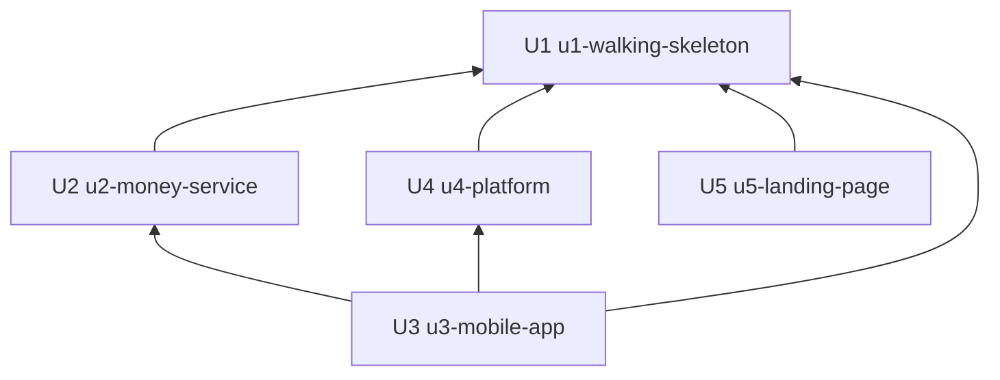

# Unit Dependencies: RAAD Digital Wallet MVP

Conversation language: English.

This document gives the dependency graph between the five units in `unit-of-work.md`. A unit depends on every unit whose code its own code or tests need to build or pass. Units with no dependency between them can be built at the same time. This is the topology only: it does not recommend a build order or name a critical path. Delivery Planning chooses the order through it. The units come from `components.md`, the plan in `units-generation-questions.md` (Q1 A, Q2 B, Q3 A) and `requirements.md`.

## Dependencies

| Unit | Depends on | Why |
|---|---|---|
| U1 `u1-walking-skeleton` | none | It is the first slice. |
| U2 `u2-money-service` | U1 | It extends the MoneyApi, Ledger and WalletDirectory code and the stacks that U1 creates in `RaadMoneyService`. |
| U3 `u3-mobile-app` | U1, U2, U4 | It extends U1's app. Its integration tests run against the real money service (U2, Q2 B) and the real sign-in settings (U4). It generates its API client from U2's complete API description. |
| U4 `u4-platform` | U1 | It extends the platform stacks that U1 creates in `Raad`. |
| U5 `u5-landing-page` | U1 | It needs no code from U1. The dependency enforces the team practice that the skeleton is approved before any other work starts. |

## Dependency Graph



Text fallback: each arrow points from a unit to a unit it depends on. U2, U4 and U5 depend on U1. U3 depends on U1, U2 and U4. There are no cycles.

## Edge Block

```yaml
units:
  - name: u1-walking-skeleton
    depends_on: []
  - name: u2-money-service
    kind: service
    depends_on: [u1-walking-skeleton]
  - name: u3-mobile-app
    kind: ui
    depends_on: [u1-walking-skeleton, u2-money-service, u4-platform]
  - name: u4-platform
    kind: packaging
    depends_on: [u1-walking-skeleton]
  - name: u5-landing-page
    kind: ui
    depends_on: [u1-walking-skeleton]
```

U1 has no `kind`, so it keeps the full design-artifact set in Construction.

## Integration Points

| Between | What crosses | How | Notes |
|---|---|---|---|
| U1 and U2 | The money service's code, data and stacks in `RaadMoneyService` | Shared repo; U2 builds on U1's code | U2 must keep U1's checks passing. |
| U1 and U3 | The app's code in `RaadMobile` | Shared repo; U3 builds on U1's screens | U3 must keep U1's integration test passing. |
| U1 and U4 | The platform's stacks in `Raad` | Shared repo; U4 builds on U1's stacks | The platform is deployed first in each environment. |
| U2 and U3 | The money API: wallet, recipient lookup, transfer and history | Synchronous HTTPS through the platform's public API address (`/money`) | The API description lives in `RaadMoneyService` and is the single source of truth; the app generates its Dart client from it (team practices). The contract itself is written in Contract Design. |
| U4 and U3 | The sign-in settings behind the account screens (password rule, the same refusal message, resend, reset, session lengths) | The app calls the sign-in service directly (ADR-007) | U3's account tests run against U4's settings in `dev`. |
| U4 and U2 | The account-confirmed signal from the sign-in service to the money service's entry point | Wired the way infrastructure design decides (domain-design finding R-02) | Not a dependency in the graph: neither unit needs the other's code to build or pass its tests. U2 tests the entry point directly. U4 tests its wiring in its stack tests. The end-to-end path (sign-up, confirmation, wallet) is checked by U3's tests, which depend on both. |
| U5 and the others | Nothing | None | The landing page calls no other unit (AC6.3.2). |

## Parallel Development

After U1, the units U2, U4 and U5 have no dependency between them and can be built at the same time, each in its own copy of the project. U3 can start once U2 and U4 are both done. Several orders fit this graph; for example U1, U2, U4, U3, U5 and U1, U5, U4, U2, U3 are both valid. Delivery Planning chooses one.

## Walking Skeleton

U1 is the only unit with no dependency, and every other unit depends on it, so it is the first unit in the dependency order. It runs before the later units because it is deployed to `dev` through each repo's own deploy path and checked by its own API smoke script and Flutter integration test (`unit-of-work.md`, Walking Skeleton).

## Sources

- `unit-of-work.md` in this stage's directory.
- `components.md` and `decisions.md` in `inception/domain-design/`.
- `units-generation-questions.md` in this stage's directory: Q1 A, Q2 B, Q3 A and the approved plan.
- `requirements.md` in `inception/requirements-analysis/`.
- `team-practices.md` in `inception/practices-discovery/`.
